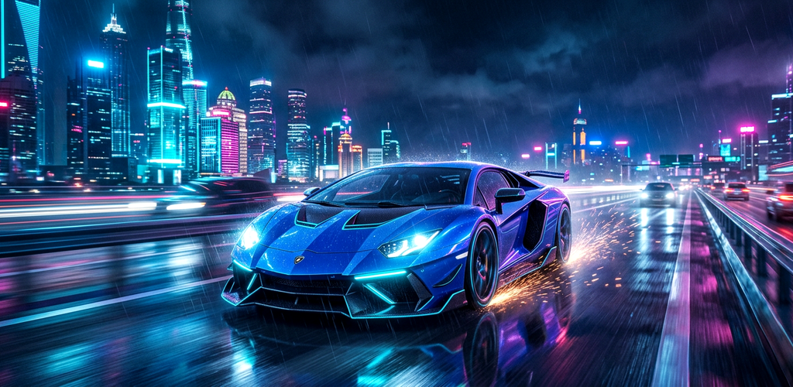
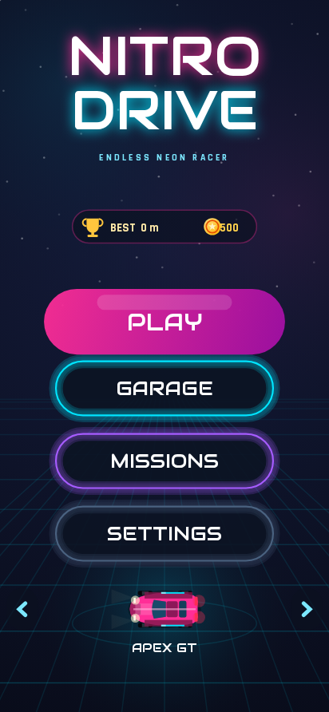
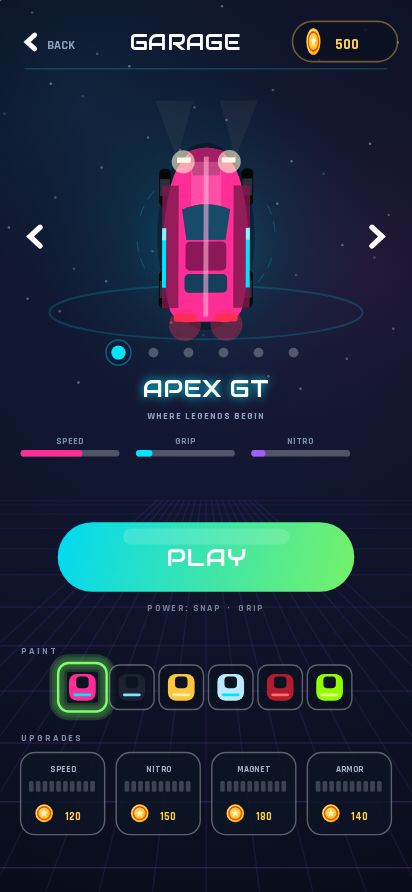
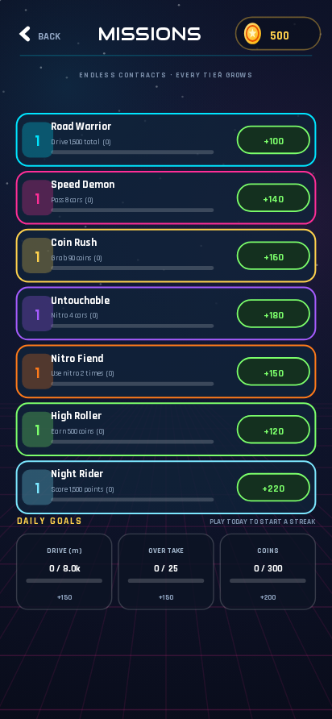
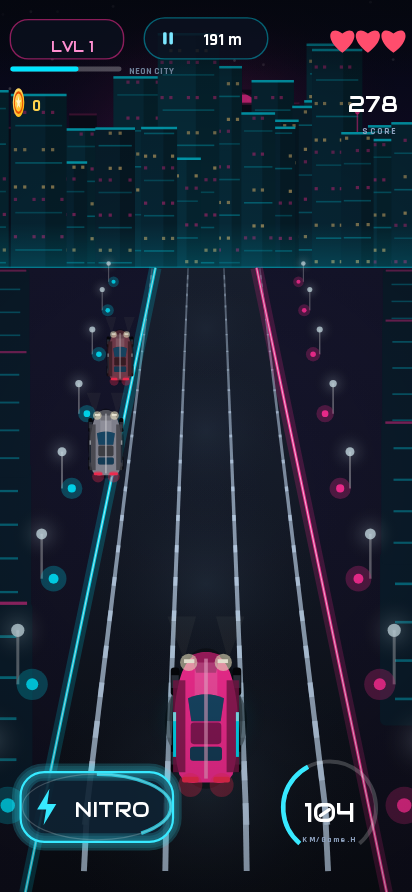
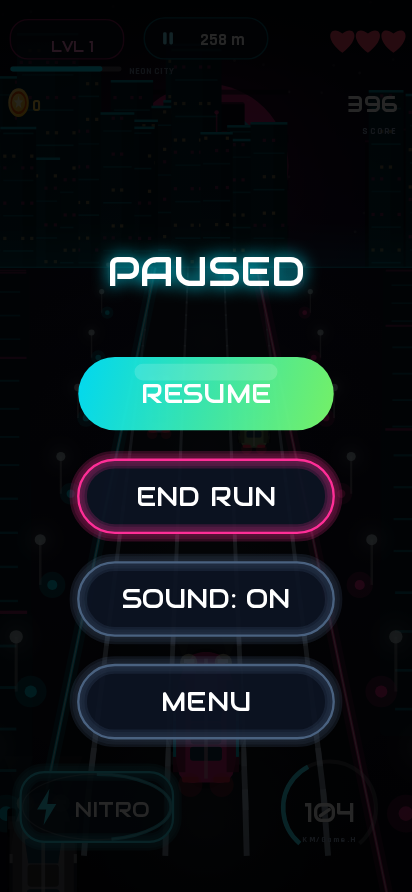
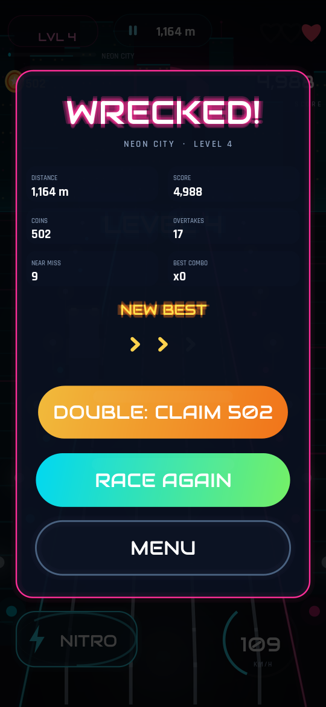

# 🏎️ Nitro Drive

**An offline, endless neon road-racer for Android. No engine, no libraries, no assets — every pixel and every sound is generated in code.**

[](https://github.com/USER/nitrodrive/actions/workflows/build.yml)




---

## Download

**[⬇ NitroDrive.apk](NitroDrive.apk)** — 2.6 MB, signed, Android 6.0+

> Self-signed, so Android will ask you to allow "install unknown apps". Play Protect may warn —
> tap **More details → Install anyway**.

---

## Screenshots

| Menu | Garage | Missions |
| :---: | :---: | :---: |
|  |  |  |

| Gameplay | Pause | Run over |
| :---: | :---: | :---: |
|  |  |  |

---

## Features

### Endless progression that never runs out
- Distance is unbounded and **level rises every 5,200 m, forever**
- Each level narrows the traffic gap and raises top speed; **twin traffic** unlocks at level 7
- **6 theme cities** rotate every 4 levels — sky, skyline, road tint and neon all shift
- **7 mission chains with infinite tiers** — clearing a tier multiplies the next target (×1.18–×1.25)
  and raises the payout, so contracts re-arm forever
- **3 daily goals** (distance / overtakes / coins) with a claimable streak

### Handling
- 5 lanes, tap left/right or swipe to change lane
- **3 lives** (+1 with the Armor upgrade)
- **Nitro boost** with a charge meter refilled by overtaking and collecting
- Pickups: **shield**, **magnet**, **coin multiplier**
- **Near-miss bonuses** and a combo multiplier for threading traffic
- Screen shake, confetti, floating score text, haptic feedback on every steering tick and crash
- Traffic variety: cars, long trucks, and **police units that change lanes**

### Garage
- **6 cars**, each with its own top speed / handling / nitro stats
- **6 paint skins** per car
- **4 upgrade tracks** — Speed, Nitro, Magnet, Armor — that persist across runs
- Everything unlockable with in-game coins (500 starting), **no IAP, no ads**

---

## Controls

| Action | Input |
| --- | --- |
| Change lane | Tap the left / right half of the screen, or swipe horizontally |
| Nitro | Tap the **NITRO** button (bottom left), needs charge |
| Pause | Tap **II** at the top centre |
| Back | System back — in-game it pauses, in menus it goes up one level |

Portrait-locked. Designed to be played one-thumbed.

---

## How it works

Everything is drawn with `android.graphics.Canvas` — there are no image assets in the game itself
and no audio files. The APK is 2.6 MB, of which ~1.3 MB is four TTF font files.

### Architecture

| File | Responsibility |
| --- | --- |
| `MainActivity.java` | Fullscreen host, immersive mode, lifecycle → save/sound |
| `GameView.java` | Render loop (`Handler` + `Runnable`), touch routing, haptics, adaptive quality |
| `Game.java` | Screen state machine, all menus/HUD, input, missions, economy wiring |
| `World.java` | Simulation (traffic, coins, pickups, collisions) + road, skyline and sky rendering |
| `CarArt.java` | Procedural car renderer — 6 models, body panels, lights, tilt/skew |
| `Draw.java` | Paint/typeface/icon helpers, glow, neon rounded rects, number formatting |
| `Store.java` | `SharedPreferences` saves, car/skin catalog, upgrade economy, mission tiers |
| `Sfx.java` | All SFX synthesised to WAV in cache and played via `SoundPool`; live engine drone |
| `Music.java` | Synthesised background loop |

### Notable details
- **Perspective model** — `World.scaleAt(y)` and `depth(y)` drive body scale, lane width and
  draw order, so traffic grows correctly as it approaches the camera.
- **Difficulty curve** — spawn gap is `max(360, 800 − 22·level)` px; doubles start at level 7;
  collision boxes are ±0.62 car-lengths and ±0.54 lane-widths.
- **Adaptive quality** — `GameView` watches frame time and drops the particle budget on slow devices.
- **Atomic saves** — `Store.save()` on every run end, pause, background and detach.

---

## Build from source

### Requirements
- JDK 17
- Android SDK build-tools 34.0.0 + platform android-34

`tools/setup_sdk.sh` downloads both into `/var/tmp/aosdk` (adjust `SDK=` in the scripts for your own paths).

```bash
bash tools/setup_sdk.sh     # one-time: SDK + build-tools
bash tools/build_apk.sh     # → NitroDrive.apk
```

The build runs `aapt2 → javac → d8 → zip → zipalign → apksigner → verify` and **fails hard** if any
source file doesn't produce a class, so a partially-compiled APK can never be signed.

Verify an existing APK at any time:

```bash
bash tools/verify_apk.sh NitroDrive.apk
```

Checks signature schemes, that a launcher activity resolves, that all 9 game classes are present in
the dex, and that the font assets shipped.

### Web build

The same Java is transpiled to a single self-contained HTML file:

```bash
python3 tools/build_web.py  # → web/index.html  (~340 KB, art + fonts inlined)
```

Open `web/index.html` in any browser — no server needed.

---

## CI

`.github/workflows/build.yml` builds a debug-signed APK on every push and uploads it as a workflow
artifact, so you don't need a local SDK to get a build.

---

## License

Code is MIT (see `LICENSE`). Bundled fonts are SIL OFL 1.1 (`app/assets/fonts/OFL.txt`) —
Audiowide, Rajdhani and Orbitron.

Not affiliated with any racing franchise. All art and audio are original and generated at runtime.
